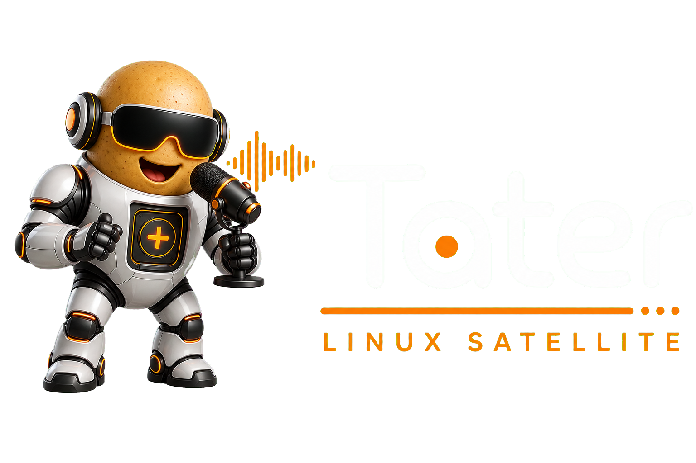

<div align="center">
  <a href="https://taterassistant.com">
    
  </a>
</div>
<h3 align="center">
  <a href="https://taterassistant.com">taterassistant.com</a>
</h3>

# Tater Linux Satellite

Turn a Linux computer, Raspberry Pi, or robot such as Reachy Mini into a
hands-free voice satellite for [Tater](https://github.com/TaterTotterson/Tater).
Wake-word detection runs locally; your connected controller handles speech recognition,
conversation, tools, and spoken replies.

You can also connect through the
[Tater Home Assistant bridge](https://github.com/TaterTotterson/Tater-Home-Assistant-Satellites).
It provides Home Assistant and Mini-Tater modes for your satellites.

## What it can do

| Feature | What you get |
| --- | --- |
| Wake words | microWakeWord, ONNX openWakeWord, and NanoWakeWord CNN/GRU, with optional dual-detector confirmation and custom wake words. |
| Natural speech | A matching wake-boundary model helps retain commands spoken immediately after the wake word, so you can say “Hey Tater, turn on the lights” without pausing. |
| False-wake prevention | **Dual mode (MWW + OWW or MWW + NWW) is recommended.** Both detectors must agree on the same wake phrase, entirely on the satellite. For **MWW-only** setups, enable **STT wake verification** in Tater or the Home Assistant bridge. |
| Conversations | Spoken replies, announcements, continued conversation, and automatic reconnects. Reply interruption is available with echo-cancelling microphone hardware. |
| Music and audio | Sendspin playback and stereo channel routing, speech ducking, announcement overlays, and audio scenes with looping backgrounds, fades, and recovery from stalled playback. |
| Timers | Local countdowns, alarms, cancel and snooze controls, and stop-word dismissal. Countdowns continue if the controller disconnects. |
| Device settings | Pair with a code, then manage wake settings, volume, name, room, and supported peripherals from your controller. Name and room changes apply live. |
| Bluetooth | On-demand discovery and a GATT proxy with secure PIN pairing. Bluetooth stays off when unused; active device connections keep it enabled. |

This is also the shared runtime used by
[Tater ThirdReality firmware](https://github.com/TaterTotterson/Tater-ThirdReality-Voice-Firmware).
That project adds the S420's hardware, setup, and signed firmware updates.

## What you need

- Linux on **amd64 or arm64**, with a microphone and speaker.
- PulseAudio, or PipeWire with PulseAudio compatibility, working on the host.
- A running Tater instance or Tater Home Assistant bridge on your network.
- Python **3.11 or newer** for a direct installation, or Docker with Compose.

A microphone array with onboard echo cancellation is useful for talking while
music or a reply is playing.

## Get started

### 1. Install

On Debian, Ubuntu, or Raspberry Pi OS with an existing audio setup:

```sh
sudo apt-get update
sudo apt-get install -y python3-venv python3-dev build-essential libmpv-dev libasound2-plugins
git clone https://github.com/TaterTotterson/Tater-Linux-Satellite.git
cd Tater-Linux-Satellite
./script/setup --onnx
```

`--onnx` enables the openWakeWord and NanoWakeWord engines. Use
`./script/setup` for a smaller microWakeWord installation.

### 2. Create a pairing code

In Tater, open **Voice & devices → Satellites** and add a satellite. If you use
the Home Assistant bridge, create the pairing code there and use its satellite
connection URL.

### 3. Pair and run

Replace the URL and code below with your own:

```sh
./script/run \
  --name "Office Satellite" \
  --tater-url http://tater.local:8501 \
  --tater-token 123456 \
  --tater-token-file ~/.config/tater-linux-satellite/device-token \
  --preferences-file ~/.config/tater-linux-satellite/preferences.json \
  --tater-device-id office-satellite \
  --tater-room Office
```

After pairing, the device token is saved. Keep the same device ID and token
file on later starts; you can remove `--tater-token` from the command.

### 4. Choose your audio and wake settings

Use the satellite settings in **Tater or the Home Assistant bridge** to choose
wake words, detector, sensitivity, wake sound, and volume. Settings are saved
for the next start.

To find or select a microphone and speaker:

```sh
./script/run --list-input-devices
./script/run --list-output-devices
```

Add `--audio-input-device "DEVICE"` or `--audio-output-device "DEVICE"` to your
start command if the system defaults are wrong.

## Prefer Docker?

The release image is
`ghcr.io/tatertotterson/tater-linux-satellite:1.2.1`, with **amd64 and
arm64** builds. `:latest` follows releases. It includes ONNX wake detection,
the boundary model, and Sendspin.

From the cloned repository:

```sh
cp .env.example .env
```

Edit `.env` with your pairing details, device name, and host user ID. For example:

```dotenv
CLIENT_NAME="Office Satellite"
TATER_URL="http://tater.local:8501"
TATER_TOKEN="123456"
TATER_TOKEN_FILE="/app/configuration/tater-token"
TATER_DEVICE_ID="office-satellite"
TATER_ROOM="Office"
```

Then start it:

```sh
docker compose up -d
docker compose logs -f linux-voice-assistant
```

The Compose file shares the host's PulseAudio/PipeWire socket and persists
pairing, preferences, and downloaded models. Set `LVA_USER_ID` and
`LVA_USER_GROUP` to your Linux user's UID and GID. After pairing, you can remove
`TATER_TOKEN` from `.env`.

For a direct installation, Sendspin is optional: follow the
[Sendspin setup instructions](docs/native_satellite.md#shared-wake-and-audio-features).

## Help and configuration

- [Native settings, wake models, Bluetooth, and Sendspin](docs/native_satellite.md)
- [Audio device options](docs/audio_options.md) and [host audio setup](docs/install_audioserver.md)
- [Buttons, LEDs, and the peripheral API](docs/peripheral_api.md)
- [Debugging](docs/debugging.md)
- [.env.example](.env.example) for container settings, or `./script/run --help` for command-line options
- [Releases and what changed](https://github.com/TaterTotterson/Tater-Linux-Satellite/releases)

## Tater projects

- [Tater Assistant](https://taterassistant.com) — downloads and project information.
- [Tater](https://github.com/TaterTotterson/Tater) — the main assistant app.
- [Home Assistant bridge](https://github.com/TaterTotterson/Tater-Home-Assistant-Satellites) — Home Assistant integration and Mini-Tater.
- [Wake Words](https://github.com/TaterTotterson/Tater-Wake-Words) — shared wake models and training requests.
- [Native firmware](https://github.com/TaterTotterson/Tater-Native-Firmware) — ESP32-S3 satellites.
- [Echo firmware](https://github.com/TaterTotterson/Tater-Echo-Firmware) — Echo satellites.
- [ThirdReality firmware](https://github.com/TaterTotterson/Tater-ThirdReality-Voice-Firmware) — S420 hardware support.
- [SAT1 RPi](https://github.com/TaterTotterson/Tater-SAT1-RPi) — Raspberry Pi satellite and embedded images for Satellite1.
- [Reachy Mini projects](docs/native_satellite.md#reachy-mini-projects).

## Development

```sh
./script/setup --dev --onnx
./script/test
./script/lint
```

Built on the Linux audio and wake-word foundation from
[OHF-Voice/linux-voice-assistant](https://github.com/OHF-Voice/linux-voice-assistant).
Licensed under [Apache 2.0](LICENSE.md). The Tater name and logo follow the
[Tater Trademark Policy](TRADEMARKS.md).
